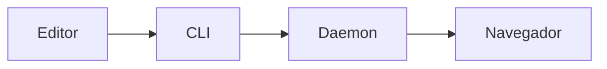

O md-preview usa `markdown-it` com HTML inline, linkify e typographer, e habilita
as extensões GFM de tabelas e riscado. Esta página cobre cada recurso com
exemplos reais.

<figure>
  
  <figcaption>Sintaxe CommonMark e GFM renderizadas no mesmo documento.</figcaption>
</figure>

## Sintaxe base

| Recurso | Sintaxe | Observação |
| --- | --- | --- |
| CommonMark | `# título`, listas, citações, links | Comportamento padrão |
| HTML inline | `<kbd>Ctrl</kbd>` | Renderizado, mas sujeito à CSP |
| Linkify | `https://exemplo.com` | URL vira link automaticamente |
| Typographer | `"aspas"` e `...` | Converte para aspas tipográficas e reticências |
| Tabelas GFM | `\| coluna \|` | Alinhamento por `:---`, `:---:`, `---:` |
| Riscado | `~~texto~~` | Renderiza `<s>` |
| Task lists | `- [x] feito` | Checkbox somente leitura |
| Footnotes | `texto[^1]` | Nota ao final do documento |
| Âncoras | títulos `h1`–`h6` | Recebem `id` para o TOC e links |
| Quebras de linha | linha em branco | Uma quebra simples não vira `<br>` |

Exemplo com os recursos mais usados:

````markdown
# Título com âncora

Texto com **negrito**, *itálico*, `código`, ~~riscado~~ e um link
https://example.com.

- [x] tarefa concluída
- [ ] tarefa pendente

| Recurso | Suporte |
| --- | :---: |
| Tabelas | sim |
| Footnotes | sim |

Uma nota de rodapé.[^1]

[^1]: O texto da nota aparece no fim do documento.
````

## Frontmatter

Um bloco YAML no início do arquivo é removido do corpo e usado pela interface:

- `title` define o título da aba e o resumo do cartão de metadados;
- todos os campos aparecem em um cartão `<details>` recolhível no topo do
  documento;
- listas viram etiquetas, objetos viram JSON em `<code>`.

```yaml
---
title: Relatório semanal
date: 2026-03-14
tags: [produto, pesquisa]
autor:
  nome: Ana
  equipe: Plataforma
---
```

<figure>
  
  <figcaption>O cartão usa `date`, depois `title`, depois “Metadata” como resumo.</figcaption>
</figure>

O conteúdo YAML não é renderizado como Markdown. Se o frontmatter estiver
ausente ou vazio, nenhum cartão é criado.

## Blocos de código

Shiki realça nove linguagens:

| Linguagem | Fence |
| --- | --- |
| JavaScript | `js` |
| TypeScript | `ts` |
| JSON | `json` |
| Lua | `lua` |
| Bash | `bash` |
| HTML | `html` |
| CSS | `css` |
| Markdown | `md` |
| Python | `py` |

```ts
type Documento = {
  slug: string;
  versao: number;
};

export function url(slug: string): string {
  return `http://127.0.0.1:8766/${slug}`;
}
```

<figure>
  
  <figcaption>Saída dupla clara/escura: o tema ativo decide qual paleta é exibida.</figcaption>
</figure>

O realce é gerado no servidor com **duas paletas** e alternado por CSS. Trocar
entre claro e escuro não renderiza o bloco de novo. Fences sem linguagem ou com
uma linguagem fora da lista continuam funcionando como bloco de código, sem
realce.

:::note[Temas do Shiki]
As oito paletas permitidas são `github-light`, `github-dark`, `dracula`, `nord`,
`solarized-dark`, `solarized-light`, `gruvbox-dark-medium` e
`gruvbox-light-medium`. Um tema do md-preview escolhe uma paleta clara e uma
escura em `shiki.light` e `shiki.dark`.
:::

## Diagramas Mermaid

Um fence com a linguagem `mermaid` vira um diagrama renderizado no navegador:

````markdown

````

<figure>
  
  <figcaption>O diagrama usa as cores do tema ativo, em variantes clara e escura.</figcaption>
</figure>

A configuração do Mermaid deriva do tema atual. A biblioteca é servida localmente
em `/__assets/mermaid.min.js`, sem CDN. Se o JavaScript estiver desabilitado, o
diagrama não é renderizado.

Clique em um diagrama para abrir o **lightbox**, com zoom pela rolagem ou pelos
botões, arrastar para mover, botão de redefinir o zoom (100%) e `Esc` para
fechar.

<figure>
  
  <figcaption>O lightbox mostra a porcentagem atual e fecha com Esc ou clique no fundo.</figcaption>
</figure>

## Tree fences

O daemon transforma fences com a linguagem `tree` em uma árvore interativa, desde
que o conteúdo seja reconhecível como saída do comando `tree`:

````markdown
```tree
meu-projeto
├── src
│   ├── index.ts
│   └── lib
│       └── util.ts
├── docs
│   └── README.md
└── package.json

3 directories, 4 files
```
````

<figure>
  
  <figcaption>Contadores mostram o total de descendentes de cada diretório.</figcaption>
</figure>

Comportamento:

- a raiz e o primeiro nível começam expandidos; níveis mais profundos começam
  recolhidos;
- clique em um diretório ou use `Enter`/`Espaço` para alternar;
- as setas navegam entre as linhas visíveis; esquerda e direita recolhem e
  expandem;
- a barra de ferramentas oferece **Expandir tudo** e **Recolher tudo**;
- saída de `tree -a` (arquivos ocultos) é aceita;
- saída de `tree -d` (somente diretórios) é detectada pelo rodapé `0 files` ou
  pela info string `tree -d`;
- quebras CRLF e códigos ANSI são normalizados;
- nomes são sempre texto escapado, nunca HTML;
- se o corpo não parecer uma árvore, o fence volta a ser um bloco de código.

## Imagens relativas

O daemon reescreve imagens com caminho relativo para `/img/<slug>/...` e as serve
**só** a partir do diretório do documento registrado:

```markdown

```

Vira:

```html

```

<figure>
  
  <figcaption>O caminho é resolvido a partir do diretório do documento, não do diretório atual do terminal.</figcaption>
</figure>

Regras:

- só extensões de imagem conhecidas são servidas;
- travessia de diretórios (`..`) e symlinks que escapam do diretório do documento
  são bloqueados;
- URLs absolutas (`https://...`), sem protocolo (`//...`) e `data:` não são
  reescritas;
- documentos registrados por `register --stdin` sem `--path` não têm diretório,
  portanto imagens relativas não são resolvidas.

## HTML inline e segurança

HTML no Markdown é renderizado, mas a página usa uma **CSP com nonce**:

| Permitido | Bloqueado |
| --- | --- |
| Tags de formatação, `<kbd>`, `<details>`, `<figure>` | `<script>` injetado |
| Atributos comuns e estilos inline | Atributos de evento inline como `onclick` |
| Imagens e links | `javascript:` em URLs |
| — | Folhas de estilo externas, frames, formulários e plugins |

Para o modelo completo, veja [Segurança e daemon](/guias/seguranca).

## O que não é suportado

- admonitions no estilo `:::note` dentro do **documento renderizado**;
- matemática KaTeX/LaTeX;
- shortcodes de emoji;
- realce para linguagens fora das nove listadas;
- busca de texto completo entre documentos.

Essas escolhas são intencionais e estão explicadas em [Limitações](/limitacoes).
