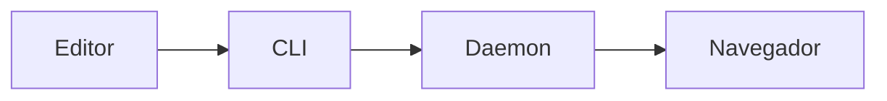

O md-preview usa `markdown-it` com HTML inline, linkify e typographer, além das
extensões GFM de tabelas, riscado, task lists, footnotes e âncoras.

## Sintaxe

| Recurso | Sintaxe | Observação |
| --- | --- | --- |
| CommonMark | `# título`, listas, citações, links | Comportamento padrão |
| Tabelas GFM | `\| coluna \|` | Alinhamento com `:---`, `:---:`, `---:` |
| Riscado | `~~texto~~` | Renderiza `<s>` |
| Task lists | `- [x] feito` | Checkbox somente leitura |
| Footnotes | `texto[^1]` | Nota ao final do documento |
| Linkify | `https://exemplo.com` | URL vira link |
| Typographer | `"aspas"` e `...` | Aspas tipográficas e reticências |
| Âncoras | títulos `h1`–`h6` | Recebem `id` para o TOC |

````markdown
# Título

Texto com **negrito**, *itálico*, `código`, ~~riscado~~ e um link
https://example.com.

- [x] tarefa concluída
- [ ] tarefa pendente

| Recurso | Suporte |
| --- | :---: |
| Tabelas | sim |

Uma nota de rodapé.[^1]

[^1]: O texto da nota aparece no fim do documento.
````

## Frontmatter

Um bloco YAML no início do arquivo é removido do corpo e exibido em um cartão
`<details>` no topo do documento. `title` também vira o título da aba.

```yaml
---
title: Relatório semanal
date: 2026-03-14
tags: [produto, pesquisa]
autor:
  nome: Ana
  equipe: Plataforma
---
```

Listas viram etiquetas e objetos viram JSON em `<code>`. Sem frontmatter, nenhum
cartão é criado.

## Blocos de código

Shiki realça as linguagens abaixo com duas paletas (clara e escura) geradas no
servidor. O fence aceita o nome completo ou um alias:

| Linguagem | Fence | Aliases |
| --- | --- | --- |
| JavaScript | `javascript` | `js`, `cjs`, `mjs` |
| TypeScript | `typescript` | `ts` |
| JSON | `json` | — |
| Lua | `lua` | — |
| Bash | `bash` | `sh`, `zsh` |
| HTML | `html` | — |
| CSS | `css` | — |
| Markdown | `markdown` | `md` |
| Python | `python` | `py` |
| Rust | `rust` | `rs` |
| Go | `go` | — |
| YAML | `yaml` | `yml` |
| TSX | `tsx` | — |
| JSX | `jsx` | — |
| SQL | `sql` | — |
| XML | `xml` | — |

```ts
export function url(slug: string): string {
  return `http://127.0.0.1:8766/${slug}`;
}
```

Fences sem linguagem ou fora dessa lista continuam como bloco de código, sem
realce, e não quebram a página. As paletas permitidas em um tema estão em
[theme.json](/referencia/theme-json).

## Diff fences

Um fence `diff` transforma uma saída unificada (`git diff`, `diff -u`) em um
bloco com numeração antiga e nova, contexto, adições e remoções. As cores vêm
do tema ativo. Trechos colados sem cabeçalho também funcionam, sem numeração —
veja [Diff simples](#diff-simples).

````markdown
```diff
diff --git a/src/cli.ts b/src/cli.ts
index 3f1c2a0..8b7d4e1 100644
--- a/src/cli.ts
+++ b/src/cli.ts
@@ -12,7 +12,8 @@ export async function main(argv: string[]) {
   const args = parse(argv);
   if (args.help) {
     printHelp();
-    return 0;
+    return args.code ?? 0;
   }
+  await warmup();
   return run(args);
 }
@@ -40,4 +41,5 @@ async function run(args: Args) {
   const theme = resolveTheme(args.theme);
-  await render(args.file, theme);
-  console.log("pronto");
+  const page = await render(args.file, theme);
+  console.log(page.url);
+  return page;
 }
```
````

Em saídas unificadas, cabeçalhos de arquivo (`diff --git`, `index` e o par
adjacente `---`/`+++`), linhas `@@` e o marcador `\ No newline at end of file`
viram linhas de metadados, sem numeração. Uma linha `---` ou `+++` isolada é
conteúdo comum do diff (por exemplo, uma remoção de comentário SQL que começa
com `-- `) e nunca vira cabeçalho. Um fence sem nenhuma linha de diff
reconhecível volta a ser um bloco de código.

Vários arquivos no mesmo fence aparecem em sequência, separados pelos próprios
cabeçalhos, sem abas.

### Diff simples

Para mostrar só um trecho, não é preciso colar a saída completa nem inventar
números de linha. Um corpo formado apenas por linhas `+`, `-` e de contexto é
tratado como diff simples; basta haver pelo menos uma linha `+` ou `-`. As
linhas de contexto podem começar com o espaço marcador clássico ou vir sem
prefixo, com a indentação normal do código preservada: um espaço inicial é
removido quando existe, então as duas formas exibem o mesmo alinhamento.

````markdown
```diff
 const total = 41;
-const next = total + 1;
+const next = total + 2;
```
````

Sem `@@` e sem cabeçalhos de arquivo não há números confiáveis, então as colunas
de numeração são omitidas: a visão inline mostra marcador e código, e a visão
lado a lado mostra marcador e código de cada lado. Contexto, pareamento e realce
por linguagem continuam funcionando. Um corpo sem nenhuma linha `+` ou `-` volta
a ser um bloco de código comum.

O nome do fence é sempre `diff`, tanto para saídas unificadas quanto para
trechos simples: não existe uma variante `gitdiff`.

### Realce por linguagem

A palavra depois de `diff` escolhe a linguagem que o Shiki usa no conteúdo:

````markdown
```diff tsx
@@ -1,7 +1,7 @@
 export function Card({ title }: CardProps) {
   return (
-    <div className="card">
+    <section className="card">
       <h2>{title}</h2>
-    </div>
+    </section>
   );
 }
```
````

````markdown
```diff go
@@ -18,7 +18,8 @@ func (s *server) handle(w http.ResponseWriter, r *http.Request) {
 	slug := r.URL.Query().Get("slug")
 	if slug == "" {
-		http.Error(w, "slug ausente", http.StatusBadRequest)
+		http.Error(w, "slug ausente: informe ?slug=", http.StatusBadRequest)
 		return
 	}
+	w.Header().Set("Cache-Control", "no-store")
 	s.render(w, slug)
 }
```
````

O valor aceita os mesmos nomes e [aliases](#blocos-de-código) dos blocos de
código. Sem ele — ou com uma linguagem fora da lista — as linhas ficam em texto
simples.

### Inline ou lado a lado

Cada bloco tem os botões **Inline** e **Lado a lado**; `aria-pressed` marca o
ativo.

| Visão | Conteúdo |
| --- | --- |
| Inline | Numeração antiga e nova em uma tabela, como no `git diff` (diffs simples não têm números) |
| Lado a lado | Duas colunas de código, antiga à esquerda e nova à direita |

No lado a lado, a *i*-ésima remoção de um trecho de mudanças fica na mesma linha
da *i*-ésima adição; sobras deixam um lado vazio.

A escolha vale para todos os diffs da página e fica em `localStorage`, na chave
`mdprv_diff_view` (`inline` ou `split`, padrão `inline`). O próximo documento
abre na última visão usada.

As duas visões já vêm renderizadas do servidor. Sem JavaScript, o bloco continua
legível na visão inline; só a troca fica indisponível.

Diffs com mais de 2000 linhas são renderizados sem realce de sintaxe. Blocos
`diff` não têm botão de copiar.

## Mermaid

Um fence `mermaid` vira um diagrama renderizado no navegador, com as cores do
tema ativo:

````markdown

````

A biblioteca é servida localmente em `/__assets/mermaid.min.js`, sem CDN. Sem
JavaScript, o bloco aparece como texto. Clique no diagrama para abrir o
lightbox com zoom (rolagem ou botões), arrastar e `Esc` para fechar.

<figure>
  
  <figcaption>O lightbox mostra a porcentagem do zoom e fecha com Esc ou clique no fundo.</figcaption>
</figure>

## Tree fences

Fences `tree` viram uma árvore de diretórios interativa quando o conteúdo é
reconhecível como saída do comando `tree`:

````markdown
```tree
meu-projeto
├── src
│   ├── index.ts
│   └── lib
│       └── util.ts
├── docs
│   └── README.md
└── package.json

3 directories, 4 files
```
````

<figure>
  
  <figcaption>Contadores mostram o total de descendentes de cada diretório.</figcaption>
</figure>

- a raiz e o primeiro nível começam expandidos; níveis mais profundos começam
  recolhidos;
- clique ou `Enter`/`Espaço` alterna um diretório; as setas navegam e
  recolhem/expandem;
- a barra de ferramentas oferece **Expandir tudo** e **Recolher tudo**;
- `tree -a` (ocultos) e `tree -d` (só diretórios, detectado pelo rodapé
  `0 files`) são aceitos;
- nomes são sempre texto escapado; se o corpo não parecer uma árvore, o fence
  volta a ser um bloco de código.

## Imagens relativas

Imagens com caminho relativo são reescritas para `/img/<slug>/...` e servidas a
partir do diretório do documento:

```markdown

```

Vira:

```html

```

Regras:

- o documento precisa ter sido registrado com um caminho em disco;
- a imagem precisa estar dentro do diretório do documento;
- `..` e symlinks que escapam do diretório retornam `404`;
- só extensões de imagem conhecidas são servidas;
- URLs absolutas, `//...` e `data:` não são reescritas.

Documentos registrados por `register --stdin` sem `--path` não têm diretório,
portanto não resolvem imagens relativas.

## HTML inline

HTML no Markdown é renderizado, mas a página usa CSP com nonce: tags de
formatação, `<details>` e `<kbd>` funcionam; `<script>` injetado, atributos
`onclick` e URLs `javascript:` não executam. O modelo completo está em
[Segurança](/recursos/seguranca).
