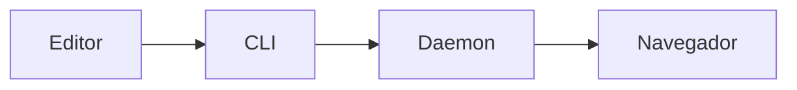

O md-preview usa `markdown-it` com HTML inline, linkify e typographer, além das
extensões GFM de tabelas, riscado, task lists, footnotes e âncoras.

## Sintaxe

| Recurso | Sintaxe | Observação |
| --- | --- | --- |
| CommonMark | `# título`, listas, citações, links | Comportamento padrão |
| Tabelas GFM | `\| coluna \|` | Alinhamento com `:---`, `:---:`, `---:` |
| Riscado | `~~texto~~` | Renderiza `<s>` |
| Task lists | `- [x] feito` | Checkbox somente leitura |
| Footnotes | `texto[^1]` | Nota ao final do documento |
| Linkify | `https://exemplo.com` | URL vira link |
| Typographer | `"aspas"` e `...` | Aspas tipográficas e reticências |
| Âncoras | títulos `h1`–`h6` | Recebem `id` para o TOC |

````markdown
# Título

Texto com **negrito**, *itálico*, `código`, ~~riscado~~ e um link
https://example.com.

- [x] tarefa concluída
- [ ] tarefa pendente

| Recurso | Suporte |
| --- | :---: |
| Tabelas | sim |

Uma nota de rodapé.[^1]

[^1]: O texto da nota aparece no fim do documento.
````

## Frontmatter

Um bloco YAML no início do arquivo é removido do corpo e exibido em um cartão
`<details>` no topo do documento. `title` também vira o título da aba.

```yaml
---
title: Relatório semanal
date: 2026-03-14
tags: [produto, pesquisa]
autor:
  nome: Ana
  equipe: Plataforma
---
```

Listas viram etiquetas e objetos viram JSON em `<code>`. Sem frontmatter, nenhum
cartão é criado.

## Blocos de código

Shiki realça nove linguagens com duas paletas (clara e escura) geradas no
servidor:

| Linguagem | Fence |
| --- | --- |
| JavaScript | `js` |
| TypeScript | `ts` |
| JSON | `json` |
| Lua | `lua` |
| Bash | `bash` |
| HTML | `html` |
| CSS | `css` |
| Markdown | `md` |
| Python | `py` |

```ts
export function url(slug: string): string {
  return `http://127.0.0.1:8766/${slug}`;
}
```

Fences sem linguagem ou fora dessa lista continuam como bloco de código, sem
realce. As paletas permitidas em um tema estão em
[theme.json](/referencia/theme-json).

## Mermaid

Um fence `mermaid` vira um diagrama renderizado no navegador, com as cores do
tema ativo:

````markdown

````

A biblioteca é servida localmente em `/__assets/mermaid.min.js`, sem CDN. Sem
JavaScript, o bloco aparece como texto. Clique no diagrama para abrir o
lightbox com zoom (rolagem ou botões), arrastar e `Esc` para fechar.

<figure>
  
  <figcaption>O lightbox mostra a porcentagem do zoom e fecha com Esc ou clique no fundo.</figcaption>
</figure>

## Tree fences

Fences `tree` viram uma árvore de diretórios interativa quando o conteúdo é
reconhecível como saída do comando `tree`:

````markdown
```tree
meu-projeto
├── src
│   ├── index.ts
│   └── lib
│       └── util.ts
├── docs
│   └── README.md
└── package.json

3 directories, 4 files
```
````

<figure>
  
  <figcaption>Contadores mostram o total de descendentes de cada diretório.</figcaption>
</figure>

- a raiz e o primeiro nível começam expandidos; níveis mais profundos começam
  recolhidos;
- clique ou `Enter`/`Espaço` alterna um diretório; as setas navegam e
  recolhem/expandem;
- a barra de ferramentas oferece **Expandir tudo** e **Recolher tudo**;
- `tree -a` (ocultos) e `tree -d` (só diretórios, detectado pelo rodapé
  `0 files`) são aceitos;
- nomes são sempre texto escapado; se o corpo não parecer uma árvore, o fence
  volta a ser um bloco de código.

## Imagens relativas

Imagens com caminho relativo são reescritas para `/img/<slug>/...` e servidas a
partir do diretório do documento:

```markdown

```

Vira:

```html

```

Regras:

- o documento precisa ter sido registrado com um caminho em disco;
- a imagem precisa estar dentro do diretório do documento;
- `..` e symlinks que escapam do diretório retornam `404`;
- só extensões de imagem conhecidas são servidas;
- URLs absolutas, `//...` e `data:` não são reescritas.

Documentos registrados por `register --stdin` sem `--path` não têm diretório,
portanto não resolvem imagens relativas.

## HTML inline

HTML no Markdown é renderizado, mas a página usa CSP com nonce: tags de
formatação, `<details>` e `<kbd>` funcionam; `<script>` injetado, atributos
`onclick` e URLs `javascript:` não executam. O modelo completo está em
[Segurança](/recursos/seguranca).
